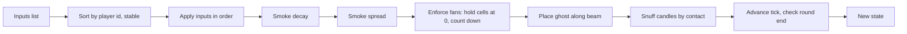

# Design Document

## Overview

This design covers the pure simulation in `src/sim` for smoke and projection. A ghost is a projection. It is solid only where the lantern beam meets enough smoke, and a bigger image is dimmer, so it needs denser smoke. The simulation is a single function, `step(state, inputs)`, over plain serializable data. It has no rendering, networking, ropes, bots or replay UI.

Design goals, in priority order:

1. Determinism. Every client and the replay must reach the same state. This is why the module uses a fixed tick, a seeded RNG stored in state, row-major updates and no clocks.
2. Readable rules. A player who loses should be able to say why. Smoke is visible, the beam is a narrow cone, and solidity is one comparison.
3. Tunability. Every number lives in `TUNING`, so playtests change a value, not code.

### Research summary

No external research was needed. The rules come from `docs/design.md` and `.kiro/steering/sim-rules.md`. Two technical points inform the design:

- Diffusion on a grid is stable and mass-conserving when each cell moves toward the average of its four neighbours using a snapshot of the previous values (a Jacobi-style update) and `4 x k <= 1`, where `k` is the per-tick spread coefficient. See [the discrete heat equation stability condition](https://en.wikipedia.org/wiki/Finite_difference_method). Content was rephrased for compliance with licensing restrictions.
- fast-check supports global configuration through `fc.configureGlobal({ numRuns })`, which is how the harness sets run counts ([fast-check docs](https://fast-check.dev/docs/configuration/global-settings/)).

### Decisions delegated to the design

The requirements left several values open. They were chosen to favour three things: readable play for friends on a voice call, a clear risk and reward trade-off for the hackathon demo and replay, and a short feedback loop for the Showman.

| Decision | Choice | Reason |
|---|---|---|
| Tick length | `tickS = 0.05` (20 Hz) | Matches the 20 Hz snapshot rate in `docs/design.md`, so one sim tick is one snapshot. A 300 s show is 6000 ticks. The grid has 192 cells, so cost is trivial. |
| Beam half-angle | `beamHalfAngleRad = 0.15` (about 8.6 degrees) | At 8 m the cone is about 2.4 m wide, so it spans two or three cells. It is narrow enough that aiming matters and wide enough that a mouse can hold it. A wide cone would make "first solid cell" feel random. |
| Image scale | linear in travel: `imageScaleMin = 0.6`, `imageScaleMax = 1.3` | See below. |
| Placeholder slide | `placeholderSlideReachM = 12` | Max distance along the beam where a ghost can appear. |
| Walls | Reflecting for smoke (zero flux), opaque for the beam | See below. |
| Shielded candle | Still snuffable by a solid ghost | Matches Requirement 9.6. Shielding hides the light, not the body. |

**Image scale mapping.** `imageScale = imageScaleMin + (imageScaleMax - imageScaleMin) x travel / cartTravelMaxM`. At the ends:

| Travel | Scale | Scaled threshold (0.5 x scale^2) | Snuff radius (0.6 x scale) |
|---|---|---|---|
| 0 m | 0.60 | 0.18 | 0.36 m |
| 4 m | 0.95 | 0.45 | 0.57 m |
| 8 m | 1.30 | 0.845 | 0.78 m |

The upper bound must satisfy `solidityThresholdBase x scale^2 <= 1`. Density is capped at 1, so any larger scale could never be solid, which would make the far end of the cart track a dead zone. 1.3 keeps the top end demanding (it needs about two stacked puffs) but reachable. The lower bound of 0.6 gives a small, fast, cheap ghost that a single puff solidifies, which supports the "small and fast" Skull slide later. The mapping is strictly increasing, as Requirement 6.7 requires.

**Walls.** Smoke does not cross the room boundary, so smoke pools near walls and corners. This rewards venting near a wall and makes corners dangerous for Spectators. The beam stops at the room boundary and cannot project through walls.

**Shielded candles.** A shield affects only the candle's light radius (a later spec). It does not protect from a solid ghost. The trade-off for Spectators is visibility against comfort, not immunity, which keeps snuffs readable: a snuff always means a solid ghost touched you.

### Starting TUNING values

All existing values come from `docs/design.md`. New values are marked.

| Field | Value | Notes |
|---|---|---|
| `tickS` | 0.05 | New |
| `showLengthS` | 300 | |
| `roomWidthM`, `roomDepthM` | 16, 12 | |
| `puffDensity`, `puffRadiusM` | 0.6, 2 | |
| `smokeDecayPerS` | 0.05 | |
| `smokeSpreadPerS` | 0.2 | Per-tick coefficient is 0.01, so `4k` = 0.04, well under 1 |
| `solidityThresholdBase` | 0.5 | |
| `cartTravelMaxM`, `cartRollSpeedMps`, `cartRushSpeedMps` | 8, 1, 4 | |
| `cartOriginXM`, `cartTrackStartYM` | 8, 2 | New. Beam origin is `(cartOriginXM, cartTrackStartYM + travel)`, so it stays inside the room for all travel (y from 2 to 10) |
| `imageScaleMin`, `imageScaleMax` | 0.6, 1.3 | New |
| `beamHalfAngleRad` | 0.15 | New |
| `placeholderSlideReachM` | 12 | New |
| `fanRadiusM`, `fanDurationS`, `fanCooldownS` | 2, 3, 8 | |
| `snuffRadiusBaseM` | 0.6 | |
| `ventPositions` | (2.5, 6), (8, 11), (13.5, 6) | New. Left wall, back wall and right wall. Stored as a list of numeric pairs in `TUNING` |
| `rngSeedDefault` | 1 | New. Used only when a caller gives no seed |

Moving the cart toward the audience grows the image, which follows Robertson's wheeled lantern.

## Architecture

The simulation is a pure function pipeline over one state value. Everything else (renderer, network, replay) reads the state.



Tick order is fixed and documented here because Requirement 4.2 and 5.2 depend on it:

1. If the round has ended, return a deep copy of the input state unchanged.
2. Stable-sort inputs by player id and apply them one by one. Cart, aim, puff, fan, candle and snuff-event inputs are handled here.
3. Decay every cell.
4. Spread from a snapshot of the decayed grid.
5. Zero every cell inside an active fan, then count each fan down by one tick and drop expired fans.
6. Recompute cart speed, beam, image scale and ghost.
7. If a solid ghost is within snuff radius of a lit or shielded candle, apply an internal snuff event with the id `tick:candleId`.
8. Increment the tick. If the new tick is at or above the show length in ticks, set `ended = true`.

Step 5 zeroes cells after spread, so spread conserves mass and the fan is a separate sink. This makes total density never increase without a puff, and it makes a fanned cell hold 0 even when a neighbour is dense.

Module layout:

```
src/sim/
  tuning.ts      TUNING, validateTuning
  rng.ts         seeded RNG (pure: next(rngState) -> [value, rngState])
  state.ts       State types, createState(seed, tuning)
  smoke.ts       puff, decay, spread, fan
  cart.ts        roll, rush, image scale
  beam.ts        beamCells, normaliseAngle
  ghost.ts       scaledThreshold, placeGhost
  candles.ts     candle transitions, applySnuffEvent
  step.ts        step, input ordering, round end
tests/sim/
  setup.ts       fast-check global config
  *.test.ts      unit and property tests
```

`step(state, inputs, tuning = TUNING)` takes an optional third argument so tests can shorten the show without touching rule code. Production callers use the default.

## Components and Interfaces

```ts
type PlayerId = number;

type Input =
  | { player: PlayerId; kind: 'puff'; vent: number }
  | { player: PlayerId; kind: 'roll'; dir: 1 | -1 }
  | { player: PlayerId; kind: 'rush'; dir: 1 | -1 }
  | { player: PlayerId; kind: 'aim'; angle: number }
  | { player: PlayerId; kind: 'fan'; x: number; y: number }
  | { player: PlayerId; kind: 'shield' | 'unshield' | 'light'; candle: number }
  | { player: PlayerId; kind: 'snuff'; eventId: string; candle: number };

function createState(seed: number, tuning?: Tuning): State;   // throws if tuning invalid
function step(state: State, inputs: readonly Input[], tuning?: Tuning): State;

// Exposed for tests and for renderers that read the same rule
function imageScale(travel: number, tuning: Tuning): number;
function scaledThreshold(scale: number, tuning: Tuning): number;
function beamCells(state: State, tuning: Tuning): Cell[];       // ascending distance, then row, then column
function placeGhost(state: State, tuning: Tuning): Ghost | null;
function applySnuffEvent(state: State, candle: number, eventId: string): State;
function validateTuning(t: Tuning): void;                       // throws naming the invalid field
```

Roles: the Showman is a fixed player id stored in state (`showmanId`). Puff, roll, rush and aim from any other player are ignored. Fan and candle inputs from the Showman are ignored.

Component notes:

- **Smoke (`smoke.ts`).** `puff` adds `puffDensity` to cells whose centre `(col + 0.5, row + 0.5)` is within `puffRadiusM` of the vent, then clamps. `decay` subtracts `smokeDecayPerS x tickS` and clamps at 0. `spread` computes `new[c] = old[c] + k x sum(old[n] - old[c])` over orthogonal neighbours that exist, with `k = smokeSpreadPerS x tickS`. Missing neighbours at walls contribute nothing, so no mass crosses a wall. Because each pair exchange is symmetric, the sum is conserved. With `4k <= 1` every result is a convex combination, so values stay within the old min and max.
- **Fans.** A fan record holds a centre and `ticksLeft`. Accepting a fan sets `ticksLeft = round(fanDurationS / tickS)` and the spectator's `fanReadyTick = tick + round(fanCooldownS / tickS)`. A cell is fanned when its centre is within `fanRadiusM` of any active fan.
- **Cart.** Rush wins over roll when both are present in a tick. Travel is clamped to `[0, cartTravelMaxM]`. Reported speed is `abs(travel after - travel before) / tickS`.
- **Beam.** `aim` normalises the angle with `((a % 2pi) + 2pi) % 2pi`. A cell is in the beam if its centre is inside the room, within `placeholderSlideReachM` of the origin, and the absolute angular difference to the beam angle is at most `beamHalfAngleRad`. The cell containing the origin is excluded because its direction is undefined. Cells are sorted by distance, then row, then column. If the origin is outside the room the list is empty.
- **Ghost.** `placeGhost` scans `beamCells` in order and returns the first cell with `density >= scaledThreshold(imageScale(travel))`, or `null`. Because every threshold is above 0, a cell fanned to 0 can never qualify. Fan enforcement also explicitly excludes fanned cells.
- **Candles.** Transitions follow Requirement 9. Snuffing, from contact or from an external event, goes through `applySnuffEvent`, which is the single place that changes a candle to snuffed.
- **RNG.** A small pure generator (mulberry32 style) with state held in `state.rng`. This spec's rules do not yet need random values, so no rule draws from it. The interface exists so later specs (bots, slide behaviour) draw from state and Requirement 1.4 holds from the start.

## Data Models

```ts
interface State {
  tick: number;
  ended: boolean;
  rng: number;                    // uint32 RNG state
  showmanId: PlayerId;
  grid: number[];                 // length W*H, row-major, each in [0, 1]
  cart: { travel: number; speedMps: number };
  beam: { angle: number };        // origin is derived from cart travel
  fans: { cx: number; cy: number; ticksLeft: number }[];
  fanReadyTick: Record<string, number>;   // key: player id as text
  candles: { id: number; x: number; y: number; status: 'lit' | 'shielded' | 'snuffed' }[];
  appliedSnuffIds: string[];      // idempotence record
  snuffedCount: number;
  ghost: { col: number; row: number; density: number; solid: boolean } | null;
}
```

All fields are numbers, booleans, strings, arrays and plain objects. There is no `undefined`, `Map`, `Set`, function, `NaN` or `Infinity`. `fanReadyTick` uses string keys so it survives a JSON round trip. `grid` is a flat array so a deep-equal comparison and a snapshot are cheap.

`Tuning` is a flat record of the numeric fields in the table above plus `ventPositions: [number, number][]`. `validateTuning` rejects any duration, radius, speed or length field that is missing, not a finite number or not positive. It also rejects `imageScaleMax < imageScaleMin`, `solidityThresholdBase x imageScaleMax^2 > 1` and `4 x smokeSpreadPerS x tickS > 1`, because those would make a ghost unreachable or the spread unstable. Errors name the field.

## Correctness Properties

*A property is a characteristic or behavior that should hold true across all valid executions of a system-essentially, a formal statement about what the system should do. Properties serve as the bridge between human-readable specifications and machine-verifiable correctness guarantees.*

Prework reflection: the idempotence and mutation criteria (1.1, 1.2, 1.6, 1.9, 1.10, 1.11) all describe determinism and purity, so they are combined into Property 1. The density-range criteria (2.4, 2.5, 2.7) and the cart-bound criteria are combined into Property 2. Criteria 4.4 to 4.7 are combined into Property 3. Criteria 8.1 to 8.4 and 8.7 are combined into Property 4. Criteria 8.5 and 8.8 are combined into Property 5. This gives the 7 properties required by Requirement 12.4.

### Property 1: Deterministic, pure replay with tick-based round end

*For any* seed and any input sequence, running the simulation twice from the same seed gives a deep-equal state at every tick; the input state and inputs are unchanged by each call; applying a permutation of inputs that have distinct player ids gives the same state; the state survives a JSON round trip; `ended` is true exactly when `tick >= showLengthS / tickS`; and stepping an ended state returns a deep-equal state.

**Validates: Requirements 1.1, 1.2, 1.6, 1.9, 1.10, 1.11**

### Property 2: Smoke density and cart travel stay in range

*For any* seed and any input sequence, after every applied input and every tick, every grid cell is a finite number in [0, 1] and cart travel is in [0, `cartTravelMaxM`].

**Validates: Requirements 2.4, 2.5, 2.7, 3.2, 6.1, 6.4**

### Property 3: Total smoke never increases without a puff

*For any* state and any input sequence containing no puff, the total density after a tick is at most the total density before it plus 1e-9. Spread alone changes the total by at most 1e-9, so no mass crosses a wall or appears from nowhere.

**Validates: Requirements 4.4, 4.5, 4.6, 4.7**

### Property 4: A ghost is solid exactly at the scaled threshold

*For any* grid, cart travel and beam angle, the placed ghost is the first cell along the beam with density at or above `solidityThresholdBase x imageScale^2`, and every earlier beam cell is below that threshold. If no beam cell reaches the threshold there is no ghost. A ghost's `solid` flag is true if and only if its cell density is at or above the threshold.

**Validates: Requirements 8.1, 8.2, 8.3, 8.4, 8.7**

### Property 5: Clearing a cell removes the threat there

*For any* state and any accepted fan, no cell inside the fan is the ghost cell and no solid ghost exists in a fanned cell, regardless of the density the cell held before the fan, and for as long as the fan is active.

**Validates: Requirements 8.5, 8.8**

### Property 6: Candles are snuffed only by a nearby solid ghost

*For any* state and any input sequence, if a candle changes from lit or shielded to snuffed during a tick, a solid ghost was within `snuffRadiusBaseM x imageScale` of that candle at that tick (or a valid external snuff event named it). Conversely, a candle with a solid ghost within that radius is snuffed at the end of the tick.

**Validates: Requirements 9.6, 9.7, 9.8, 9.9**

### Property 7: Snuff events are idempotent

*For any* state and any snuff event, applying the same event twice in sequence gives a state equal to applying it once, and the snuffed count rises by at most 1.

**Validates: Requirements 10.1, 10.2, 10.3, 10.5**

## Error Handling

| Situation | Behaviour |
|---|---|
| Invalid TUNING field | `createState` and `step` throw an error naming the field (Req 11.3) |
| Puff names a missing vent, or comes from a non-Showman | Input ignored, grid unchanged (Req 3.5, 3.6) |
| Fan outside the room or during cooldown | Input ignored, no cooldown started or changed (Req 5.4, 5.6) |
| Aim with a non-finite angle | Input ignored (Req 7.2) |
| Non-finite or out-of-range density from arithmetic | Clamped to 0 or 1 (Req 2.6) |
| Snuff event for a missing candle, a snuffed candle, or an applied id | State returned unchanged (Req 10.2 to 10.4) |
| Candle input on a snuffed candle | Stays snuffed (Req 9.5) |
| Candle input from the Showman, or unknown input kind | Ignored |
| Any input on an ended round | State returned unchanged (Req 1.10) |
| Beam origin outside the room | Empty beam list, no ghost (Req 7.7) |
| `FC_NUM_RUNS` invalid | Falls back to 100, setup does not throw (Req 12.3) |

Ignoring bad inputs, not throwing, keeps one misbehaving client from stopping the shared simulation.

## Testing Strategy

Property-based testing applies here. The simulation is a pure function with a large input space (seeds, input sequences, grids), which is where generated inputs find edge cases.

**Libraries.** `vitest` for the runner and `fast-check` for properties. No property-testing code is hand-written.

**Dual approach.**

- Property tests cover Properties 1 to 7. Each property is implemented by exactly one `fc.assert(fc.property(...))` test (Req 12.4).
- Unit tests cover examples and edge cases: grid dimensions, a single puff on an empty grid, decay and spread with exact numbers, fan hold and release, cooldown, roll and rush precedence, aim normalisation, beam ordering, candle state transitions, TUNING validation, and the `FC_NUM_RUNS` parser.
- A source scan test (or lint rule) checks that `src/sim` has no `Math.random`, `Date.now`, `performance.now`, timers or DOM and Three.js imports, and no numeric literals other than 0 and 1 outside `tuning.ts`.

**Configuration.**

- Each property test runs at least 100 iterations, from the global config below.
- Each test has a comment tag in the form `Feature: smoke-and-projection, Property N: <title>`.
- fast-check reports the failing seed and the shrunk counterexample in vitest output by default (Req 12.5).
- Property tests import only from `src/sim`, `vitest` and `fast-check` (Req 12.6).

**Arbitraries.** Seeds are 32-bit integers. An input arbitrary builds each input kind with valid and invalid values (bad vent index, NaN angle, out-of-room fan). A grid arbitrary produces 192 densities in [0, 1], with biased variants for empty, full and edge-heavy grids. Tests for Property 1's round end build state with a short `showLengthS` (for example 2 s) passed through the tuning argument.

**Vitest setup file** (`tests/sim/setup.ts`, registered in `vitest.config.ts` as `setupFiles`):

```ts
import fc from 'fast-check';

const DEFAULT_RUNS = 100;
const MAX_RUNS = 1_000_000;

// Returns a base-10 integer in [1, 1_000_000], else the default.
export function parseNumRuns(raw: string | undefined): number {
  if (raw === undefined || raw === '') return DEFAULT_RUNS;
  if (!/^[0-9]+$/.test(raw)) return DEFAULT_RUNS;
  const n = Number.parseInt(raw, 10);
  return n >= 1 && n <= MAX_RUNS ? n : DEFAULT_RUNS;
}

fc.configureGlobal({ numRuns: parseNumRuns(process.env.FC_NUM_RUNS) });
```

Local runs use the default 100 for speed. CI sets `FC_NUM_RUNS=1000` for deeper runs.

**Where the Property_Suite lives.** The `parseNumRuns` unit tests are the one exception that imports the setup file; they test the parser as a plain function and are not counted among the 7 properties.
