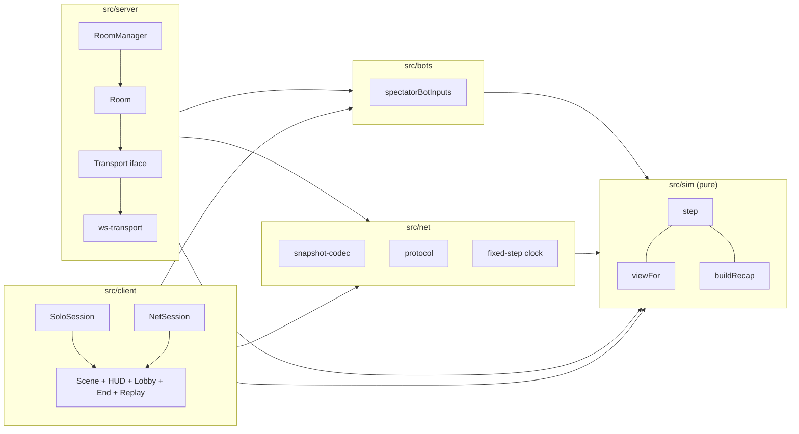

# Design Document

## Overview

This design turns the headless simulation into a playable vertical slice: one room, 1 Showman and 3 Spectators, bots in empty Spectator seats, join by link, a Three.js grey-box client, an authoritative Node server, a HUD, an end screen with recap and top-down replay, a solo mode that runs without the server, and a one-command local run.

The work splits into five parts that mirror the repository layout from `.kiro/steering/structure.md`:

- `src/sim`: extend the pure simulation with ropes, Spectator movement, candle light radii, the round outcome, the per-role `View` function and the `Recap` function.
- `src/bots`: the Spectator_Bot, moved out of `src/sim` and extended with a rope objective.
- `src/net`: the extended Snapshot_Codec, the control-message protocol and a pure fixed-step clock shared by server and solo client.
- `src/server`: rooms with Phases, seats, reconnect, the State_Log and input log, plus two small HTTP routes behind the Transport.
- `src/client`: Three.js scene, input mapping, HUD, lobby, end screen, replay, net session and solo session.

Design goals, in priority order:

1. One rule set. Solo and networked play run the same `step`, the same bots, the same `viewFor`, the same renderer and the same HUD. Only the session object differs.
2. Determinism. `step` stays pure. The server records every input list it feeds to `step`, so replaying the log reproduces the final state.
3. A playable solo build first. The sim, bots, view and client are built and playable in one browser tab before any new networking is written.
4. Tunability. Every new rule number goes in `TUNING`. Client and server constants that are not rules are named `SCREAMING_SNAKE_CASE` constants.

### Research summary

No external research was needed for the rules. The following facts from the repository and a few library behaviours shape the design.

- Existing code. `src/sim` has `createState`, `step`, smoke, cart, beam, ghost, candles and `spectatorBotInputs`. `src/net/snapshot-codec.ts` already encodes the grid as sparse or dense `u16` changes against a per-connection baseline. `src/server` has `Room`, `RoomManager` (a catch-up loop), a `Transport` interface and a `ws` transport. The spike under `spikes/net` chose `ws` over Colyseus, and its report sets the 20 Hz loop, the 10 s grace and the 10 Hz log.
- Vite proxies WebSocket upgrades when a proxy entry sets `ws: true`, and a proxy entry may define `bypass(req)` to serve a different path. A `bypass` that returns `/index.html` for non-upgrade requests lets the same path `/r/<CODE>` serve the client page over HTTP and the game socket over WebSocket ([Vite server options](https://vite.dev/config/server-options.html)). Content was rephrased for compliance with licensing restrictions.
- Vite blocks unknown `Host` headers by default, so the tunnel host must be listed in `server.allowedHosts` (same page).
- A Three.js `DataTexture` with `NearestFilter` gives one texel per smoke cell and can be updated in place each snapshot ([Three.js DataTexture](https://threejs.org/docs/#api/en/textures/DataTexture)).
- Cloudflare quick tunnels forward WebSocket traffic, so one tunnelled Vite port can carry the page and the socket ([Cloudflare quick tunnels](https://developers.cloudflare.com/cloudflare-one/connections/connect-networks/do-more-with-tunnels/trycloudflare/)).

### Decisions delegated to the design

| Decision | Choice | Reason |
|---|---|---|
| Cut_Progress storage | Integer ticks (`cutProgressTicks`); seconds are `ticks x tickS`. The hold threshold is `max(1, round(ropeCutHoldS / tickS))` ticks. | Summing `0.05` eighty times in floating point misses 4 s by an ulp. Integers keep the cut Tick exact and the codec lossless. |
| Candle position | Derived. `candle.x/y` always equal the owning Spectator's `x/y`. The codec does not send candle positions and the decoder copies them from Spectators. | Removes a duplicate source of truth and about 16 bytes per candle in full frames. |
| Ownership | The Nth Spectator (by ascending player id, skipping the Showman) owns candle N. `shield`, `unshield`, `light` and `cut` apply only to the sender's own candle. A `fan` from a Spectator with a snuffed candle is ignored. | The glossary says the Audience_Side cannot fan or cut. Without an ownership check, a client could shield another player's candle by naming its id. |
| Showman id | `createState(seed, tuning, { showmanId })`. Spectators are the other three seat ids in ascending order. | Rematch rotation (Requirement 3.8, 7.7). |
| Outcome and `ended` | `outcome` is set on the same Tick `ended` becomes true. `ended` stays as the freeze flag. | Keeps the existing freeze rule and tests. |
| Candle list vs. `candlePositions` | `TUNING.candlePositions` is removed. Candles are built from `spectatorStartPositions`. | Requirement 16.3. |
| Bot home | `src/bots/spectator-bot.ts`. `src/sim/index.ts` stops exporting `spectatorBotInputs`. | The module layout asks for `src/bots`. `sim` must import nothing from other layers, so bots import `sim` and are not re-exported from it. |
| Waiting seats during grace | A grace-period Spectator seat is idle (no bot input) until the grace ends, then a bot takes it. | Matches Requirement 6.7 and 6.9 and avoids a bot fighting a returning human. |
| Late joiner | A human who joins a running Round takes the lowest free seat. If that seat was a bot seat, the bot stops and the human controls that Spectator. | Requirement 6.2 with 6.9. |
| Room-level clock | `Room.clockTicks` counts every `Room.tick()` call, including `lobby`. Grace and the 60 s empty timeout use it. | `state.tick` freezes in `lobby` and `ended`. A grace measured in sim Ticks would never expire there. |
| State_Log on the wire | The server keeps full `State` entries and the input list. It sends the client `ReplayFrame[]` (no grid, no rng). `GET /log/<CODE>` returns the full log. | A 300 s Round has about 3000 logged states with 192-cell grids each. The replay needs only cart, beam, ghost, ropes, spectators and candles. |
| Room code allocation | `GET /new` returns `{ "code": "ABCD" }`, unique among live rooms. The client navigates to `/r/<code>`. The Room itself is created on first WebSocket join (Requirement 6.4). | Satisfies Requirement 6.1 without a second Room creation path. `/new` joins the proxied paths in the dev setup. |
| Playwright | Added as a dev dependency for Requirement 17.6 only. | It is a free test tool and the requirement calls for it. |

### Starting TUNING additions

| Field | Value | Note |
|---|---|---|
| `ropeCount` | 3 | |
| `ropePositions` | `[[2.5, 9.5], [13.5, 9.5], [8.5, 6.5]]` | Two far corners and one near the cart track, so cutting means leaving cover. |
| `ropeCutHoldS` | 4 | |
| `ropeCutRadiusM` | 1 | |
| `litCandleRadiusM` | 3 | |
| `shieldedCandleRadiusM` | 1 | |
| `spectatorSpeedMps` | 3 | |
| `spectatorStartPositions` | `[[2.5, 1.5], [13.5, 1.5], [8.5, 4.5]]` | Replaces `candlePositions`. |
| `fanReachM` | 4 | Used by the client only. |
| `nearMissRadiusM` | 1 | Used by `buildRecap`. |

`validateTuning` also rejects `ropePositions.length !== ropeCount`, `spectatorStartPositions.length !== 3`, and any rope or start position outside the room. Errors name the field.

## Architecture



Dependency direction follows `structure.md`: `sim` imports nothing from other layers. `bots` and `net` import `sim` types and functions through its public entry point. `server` and `client` import `sim`, `bots` and `net`, and never each other.

### Module layout

```
src/sim/
  tuning.ts        + rope, spectator, radius, recap numbers; validation
  state.ts         + Rope, Spectator, Outcome; createState(seed, tuning, opts)
  ropes.ts         cut phase (new)
  spectators.ts    move phase, ownership, light radius (new)
  outcome.ts       end-of-tick outcome rule (new)
  view.ts          viewFor, beamLitCells (new)
  recap.ts         buildRecap, ReplayFrame (new)
  step.ts          new phases wired in
  rng.ts           + deterministicRoll(state, player)
src/bots/
  spectator-bot.ts rope objective + existing defence
src/net/
  protocol.ts      + start, rematch, resync, roster, log, phase
  snapshot-codec.ts + ropes, spectators, outcome, derived candle positions
  fixed-step.ts    pure fixed-step clock (new)
  room-code.ts     pattern, generator helpers (new)
src/server/
  transport.ts     + HttpHandlers
  ws-transport.ts  + GET /new, GET /log/<CODE>
  room.ts          Phase machine, seats, bots, logs
  room-manager.ts  code allocation, loop using the fixed-step clock
  index.ts         PORT, default port, port-in-use message
src/client/
  main.ts, app.ts                 screen state machine
  session/ session.ts net-session.ts solo-session.ts ws-url.ts
  input/ bindings.ts controls.ts input-mapper.ts keyboard-mouse.ts
  render/ scene.ts camera.ts floor-projection.ts smoke-texture.ts
          actors.ts beam.ts particles.ts interpolation.ts palette.ts
  ui/ hud-model.ts hud.ts notices.ts lobby.ts start-screen.ts
      error-screens.ts end-screen.ts replay-controller.ts replay-canvas.ts
      styles.css
index.html, vite.config.ts, playwright.config.ts
scripts/dev.mjs
e2e/two-pages.spec.ts
docs/playtest-checklist.md, README.md
tests/{sim,bots,net,server,client}/...
```

### Extended tick order

`step` keeps its structure and adds three phases. New phases are marked.

1. Ended or outcome set: return a deep copy.
2. Apply inputs sorted by player id. `move` and `cut` inputs are collected, not applied yet. Last `move` per player wins.
3. **Move phase**: apply each collected `move` to its Spectator, then clamp to the room.
4. **Sync candle positions** to Spectator positions.
5. **Rope phase**: compute Cutters from the inputs, update `cutProgressTicks`, set cut ropes.
6. Decay, spread, fans, cart, ghost (unchanged).
7. Snuff by contact (unchanged, now uses current candle positions).
8. **Outcome phase**: ropes first, then candles, then time.
9. Advance the Tick, set `ended` when `outcome !== null`.

The move phase runs before the rope phase so a Spectator who steps into range and holds cut in the same Tick counts. `shield` applied in phase 2 is visible to phase 5, so a shielded Candle cannot cut. Snuff happens after the rope phase, so a Cutter whose Candle is snuffed this Tick still advanced the rope this Tick, which is what makes the same-Tick tie rule in Requirement 3.4 reachable.

### Server loop

`FixedStepClock` is a pure object in `src/net/fixed-step.ts`:

```ts
export interface FixedStepClock {
  /** Returns how many steps are due at `nowMs`, and advances the internal due time. */
  advance(nowMs: number): number;
}
export function createFixedStepClock(startMs: number, stepMs: number, maxCatchUp: number): FixedStepClock;
```

`advance` returns `floor((nowMs - nextDueMs) / stepMs) + 1` when `nowMs >= nextDueMs`, else 0. If the result exceeds `maxCatchUp` (`MAX_CATCH_UP_TICKS = 40`, two seconds), the clock drops the surplus and sets `nextDueMs = nowMs + stepMs`, so a laptop sleep does not trigger a burst of thousands of ticks. Below that bound, no step is lost, so the long-run rate is `1 / tickS`. `RoomManager.start` runs `setTimeout` with the delay to the next due time, calls `tickAll()` that many times, and repeats. The solo session uses the same clock with `requestAnimationFrame` as its driver.

## Components and Interfaces

### Sim additions

```ts
export type RopeStatus = 'standing' | 'cut';
export interface Rope {
  id: number; x: number; y: number;
  status: RopeStatus;
  cutProgressTicks: number;   // integer in [0, ropeCutHoldTicks]
  cutTick: number | null;     // Tick on which the rope was cut
}
export interface Spectator { player: PlayerId; candleId: number; x: number; y: number }
export type OutcomeReason = 'all_candles_snuffed' | 'time_up' | 'all_ropes_cut';
export interface Outcome { winner: 'showman' | 'spectators'; reason: OutcomeReason; tick: number }

// Input additions
| { player: PlayerId; kind: 'move'; dx: number; dy: number }
| { player: PlayerId; kind: 'cut'; rope: number }

export function createState(seed: number, tuning?: Tuning, opts?: { showmanId?: PlayerId }): State;
export function lightRadiusM(status: CandleStatus, tuning?: Tuning): number;
export function ropeCutHoldTicks(tuning?: Tuning): number;
export function cutProgressS(rope: Rope, tuning?: Tuning): number;
```

`ropes.ts` exports `isCutter(state, player, ropeId, tuning)`: sender is a non-Showman Spectator, candle `lit`, rope `standing`, and distance from the Spectator to the rope is at most `ropeCutRadiusM` (inclusive). `applyRopePhase(state, cutInputs, tuning)` builds the set of rope ids with at least one Cutter, so several Cutters count once. A rope in that set gets `cutProgressTicks + 1`, capped at the hold; every other standing rope resets to 0. A rope reaching the hold becomes `cut` with `cutTick = state.tick`. Cut ropes never change again.

`outcome.ts` exports `decideOutcome(state, tuning): Outcome | null`, checked in this order, so the same-Tick tie goes to Spectators: (1) no standing rope, `spectators` / `all_ropes_cut`; (2) no `lit` or `shielded` candle, `showman` / `all_candles_snuffed`; (3) `state.tick + 1 >= showLengthS / tickS`, `showman` / `time_up`. The Tick stored is `state.tick + 1`, the Tick after the step.

### View

```ts
export interface ViewCell { index: number; density: number }
export interface View {
  tick: number;
  outcome: Outcome | null;
  ropesCut: number;
  ownCandle: CandleStatus | null;   // null for the Showman
  ownFanReadyInTicks: number;       // 0 when ready; 0 for the Showman
  cart: { travel: number };
  beam: { angle: number } | null;   // null on the Audience_Side
  cells: ViewCell[];                // only the cells the viewer may see
  ropes: Rope[];
  spectators: Spectator[];
  candles: Candle[];
  ghost: Ghost | null;
}
export function viewFor(state: State, player: PlayerId, tuning?: Tuning): View;
export function beamLitCells(state: State, tuning?: Tuning): Cell[];
```

`beamLitCells` is `beamCells` filtered to cell centres within `placeholderSlideReachM` of the beam origin. Visibility by role, using cell centres for cells and exact positions for entities, with inclusive radius tests:

| Viewer | Cells | Ropes, Spectators | Candles | Ghost |
|---|---|---|---|---|
| Showman | Beam_Lit_Cells, plus cells within a lit Candle's radius | in a Beam_Lit_Cell or within a lit Candle's radius | every lit Candle; others only in a Beam_Lit_Cell | only if its cell is a Beam_Lit_Cell |
| Spectator, lit or shielded | cells within own Light_Radius | within own Light_Radius, plus the viewer's own Spectator | own Candle, every lit Candle, others within own radius | every solid ghost; a non-solid ghost within own radius |
| Spectator, snuffed | every cell | all | all | the ghost |

Every View carries `tick`, `outcome`, `ropesCut`, `ownCandle` and `ownFanReadyInTicks`. The Audience_Side View has `beam: null`. The function copies data and never returns references into `state`.

### Recap

```ts
export interface ReplayFrame {
  tick: number;
  cart: { travel: number }; beam: { angle: number };
  ghost: Ghost | null;
  ropes: Rope[]; spectators: Spectator[]; candles: Candle[];
  outcome: Outcome | null;
}
export interface Recap {
  snuffs: { tick: number; candleId: number; x: number; y: number }[];
  ropeCuts: { tick: number; ropeId: number; x: number; y: number }[];
  nearMisses: number;
  lastRopeCutTick: number | null;
}
export function toReplayFrame(state: State): ReplayFrame;
export function buildRecap(frames: readonly ReplayFrame[], tuning?: Tuning): Recap;
```

`State` satisfies the `ReplayFrame` shape for `buildRecap` through `toReplayFrame`. A snuff is a candle whose status becomes `snuffed` between two consecutive frames; a rope cut is a rope that becomes `cut`. The time of an event is the tick of the first frame that shows it. A Near_Miss counts one contiguous run per candle: frames where a solid ghost is within `nearMissRadiusM` of that candle while it is not snuffed, ended by the ghost leaving the radius. A run that ends in a snuff is not a Near_Miss.

### Spectator_Bot

`spectatorBotInputs(state, botPlayers, tuning)` in `src/bots/spectator-bot.ts` keeps the existing defence and adds the objective. Per bot, per Tick:

1. Snuffed candle: no input.
2. Roll `deterministicRoll(state, player)` (derived from `state.rng`, `tick`, `player`; never writes the rng) against `botReactChancePerTick`.
3. Threatened (solid ghost within `snuffRadiusBaseM x imageScale + botWarnMarginM`): if the roll passes, fan when ready (one fan per Tick across bots) else shield a lit candle. In all threatened cases the bot sends no `move` or `cut` that Tick (Requirement 5.4).
4. Not threatened and shielded: `unshield` and nothing else that Tick.
5. Not threatened, lit, a standing rope exists: pick the nearest standing rope (ties to the lower id). Within `ropeCutRadiusM`: send `cut`. Otherwise send `move` with the vector to the rope.

### Protocol

```ts
// client -> server (JSON text)
{ t: 'in'; input: ClientInput }   // ClientInput gains 'move' and 'cut'
{ t: 'start' } | { t: 'rematch' } | { t: 'resync' } | { t: 'ping'; ts: number }

// server -> client
{ t: 'hello'; player; role; token; code; phase }
{ t: 'roster'; phase; showman: number; seats: SeatInfo[]; rematchPending: boolean; graceTicksLeft: (number|null)[] }
{ t: 'log'; frames: ReplayFrame[]; recap: Recap }
{ t: 'pong'; ts: number }
// server -> client (binary): Snapshot

type Phase = 'lobby' | 'playing' | 'ended';
type SeatKind = 'human' | 'bot' | 'open';
interface SeatInfo { seat: number; kind: SeatKind; role: 'showman' | 'spectator'; connected: boolean }
```

`CLIENT_INPUT_KINDS` becomes `puff, roll, rush, aim, fan, shield, unshield, light, move, cut`. `snuff` stays server-only. `parseClientMessage` validates `move` (finite `dx`, `dy`) and `cut` (integer `rope`) shapes and rejects unknown `t` values. `start`, `rematch` and `resync` take no payload.

### Snapshot_Codec changes

The existing layout stays. These parts change:

- Candle section: per candle only a `u8` status. Full frames also send the id. Candle `x` and `y` are removed from the wire and rebuilt from Spectators on decode.
- New Spectator section: `u8 count`; full frames add `u8 player`, `u8 candleId` per entry. Every frame carries `f64 x, f64 y` per Spectator, preceded by a `u8` bitmask of Spectators that changed since the baseline. Unchanged Spectators send no coordinates.
- New Rope section: `u8 count`; full frames add `f64 x, f64 y` per rope. Every frame carries per rope `u8 status`, `u16 cutProgressTicks`, `u32 cutTick` (`0xffffffff` for null).
- New Outcome section: `u8` flag bits in the existing flag byte (bit 4 outcome present), then `u8 winner`, `u8 reason`, `u32 tick`.
- Smoke grid: unchanged. Cells are already delta-coded as sparse `(u16 index, u16 value)` pairs against the baseline, with a dense fallback and a full frame when the baseline is `null`. The slice keeps that format.
- `fanReadyTick` and `fans` already travel and need no change.

`decodeSnapshot` throws `SnapshotCodecError` on short buffers, bad enums or out-of-range counts. `quantizeState` quantises the grid only, as today; ropes and positions are lossless (`f64`).

### Server

```ts
export type Phase = 'lobby' | 'playing' | 'ended';
export class Room {
  readonly code: string;
  phase: Phase;
  join(conn: Connection, token: string | null): ConnectionHandlers | null;
  tick(): void;                      // one wall-clock tick of the room
  get log(): RoomLog | null;         // after a Round ends
  get humanCount(): number;
}
export interface RoomLog { states: State[]; inputs: Input[][] }   // states[0] is the first state
```

Seat model: four `Seat | null` entries. A `Seat` holds `token`, `conn | null`, `releaseAtClockTick | null` and `baseline`. Seat index equals player id. `showmanSeat` is a number.

`Room.tick()` per call:

1. `clockTicks++`.
2. `lobby`: no step. Release grace-expired seats. Reassign `showmanSeat` if needed. Send nothing unless the roster changed.
3. `playing`: build the input list (stamped human inputs, then `spectatorBotInputs` for bot seats), call `step`, push the input list to `inputs`, record the state every `RECORD_EVERY_TICKS` and on the final Tick, send one Snapshot per connected seat. If `outcome !== null`, set `phase = 'ended'`, send roster and the `log` message. If the Showman seat is past grace, discard the Round, `phase = 'lobby'`, release the seat.
4. `ended`: release grace-expired seats.
5. Delete rule: the manager removes a room after `ROOM_EMPTY_TTL_TICKS = 1200` consecutive `clockTicks` with no held seat.

Bot seats are computed each Tick: every seat that is not `showmanSeat` and holds no `Seat` object. A seat in grace holds a `Seat` object, so it is idle.

Start: only the Showman's `start` message works in `lobby`. It creates `createState(seed, TUNING, { showmanId: showmanSeat })` with `seed = randomInt(2^32)`, clears logs, sets `playing`, and sends a full Snapshot to every connected seat.

Rematch: in `ended`, a `rematch` from any human sets `rematchPending`. When the sender is the Showman, or the Showman seat holds no connected human, the room moves to `lobby`: `showmanSeat` becomes the next held seat in ascending order after the current one, wrapping, or stays when only one human is held. A pending request from a non-Showman waits for the Showman's own `rematch` and shows in the roster.

Transport additions:

```ts
export interface HttpHandlers {
  newRoomCode(): string;                    // GET /new -> {"code": "..."}
  roomLog(code: string): RoomLog | null;    // GET /log/<CODE> -> JSON, 404 when null
}
export interface Transport { listen(port: number, handlers: TransportHandlers, http: HttpHandlers): Promise<void>; close(): Promise<void> }
```

`ws-transport` maps `GET /new` and `GET /log/<CODE>` to those handlers on the same HTTP server that accepts WebSocket upgrades at `/r/<CODE>`. A bad code at upgrade closes with `CLOSE_BAD_CODE = 4000` and a reason. `index.ts` reads `PORT`, defaults to `DEFAULT_PORT = 2568`, and on `EADDRINUSE` prints the port number and exits with code 1.

### Client

```ts
export type SessionEvent =
  | { kind: 'hello'; player: number; role: Role; code: string; phase: Phase }
  | { kind: 'roster'; roster: Roster }
  | { kind: 'state'; state: State; receivedAtMs: number }
  | { kind: 'log'; frames: ReplayFrame[]; recap: Recap }
  | { kind: 'connection'; status: 'connected' | 'reconnecting' | 'closed'; graceSecondsLeft: number }
  | { kind: 'error'; error: 'bad_code' | 'room_full' | 'unreachable' };

export interface GameSession {
  subscribe(listener: (e: SessionEvent) => void): () => void;
  sendInput(input: ClientInput): void;
  start(): void;
  rematch(): void;
  dispose(): void;
}
```

`NetSession` opens `wss://` or `ws://` from `location` (`ws-url.ts`), keeps the Seat_Token in `sessionStorage` under the Room_Code, decodes Snapshots against its last good State, and on `SnapshotCodecError` keeps the last good State and sends `resync`. On an unexpected close it retries every `RECONNECT_RETRY_MS = 500` and counts down `RECONNECT_GRACE_S = 10`.

`SoloSession` owns a `State`, a `FixedStepClock` and a `requestAnimationFrame` driver. Each due step calls `step(state, [...humanInputs, ...spectatorBotInputs(state, [1, 2, 3])])`. The human is player 0 and the Showman. The seed comes from `crypto.getRandomValues`. It emits the same `hello`, `roster`, `state` and `log` events and opens no WebSocket.

Input mapping is a pure function so it is unit-testable without a DOM:

```ts
export interface ControlState {
  held: ReadonlySet<string>;          // 'KeyW', 'Shift', 'Mouse0', ...
  pressed: readonly string[];         // edge presses since the last mapping
  mouseFloor: { x: number; y: number } | null;
}
export function mapInputs(c: ControlState, ctx: { role: Role; phase: Phase; view: View; self: Spectator | null; cartOrigin: { x: number; y: number } }, tuning?: Tuning): ClientInput[];
```

Bindings live in `bindings.ts`, and the HUD reads the same table:

| Role | Control | Key |
|---|---|---|
| Showman | roll forward / back | W / S |
| Showman | rush | Shift with W or S |
| Showman | Vent 1, 2, 3 | 1, 2, 3 (edge press only) |
| Showman | aim | mouse position on the floor |
| Spectator | move | W, A, S, D |
| Spectator | shield / unshield | Space (edge press) |
| Spectator | fan | left mouse button (edge press), target clamped to `fanReachM` of the Spectator |
| Spectator | cut | E held |

`mapInputs` returns `[]` unless `phase === 'playing'`. A Showman gets only Showman kinds, a Spectator only Spectator kinds, and a Spectator with `ownCandle === 'snuffed'` gets only `move`. Fan is suppressed while `ownFanReadyInTicks > 0`. Cut names the nearest standing rope within `ropeCutRadiusM` of the Spectator's own position, taken from the View.

Rendering, all in `src/client/render`:

- `floor-projection.ts`: `simToWorld(x, y) = (x, 0, -y)` and `screenToFloor` using a ray against the `y = 0` plane. Screen up is `+y` in the sim, so the default beam angle of pi/2 points up the screen.
- `camera.ts`: perspective camera at `CAMERA_HEIGHT_M` above the hall centre, tilted back by `CAMERA_TILT_M`.
- `smoke-texture.ts`: a 16 by 12 RGBA `DataTexture` on the floor plane with `NearestFilter`. Cells not in `view.cells` get opaque black. Visible cells get smoke colour with alpha proportional to density.
- `beam.ts`: a flat cone mesh from the Cart along `view.beam.angle` with half-angle `beamHalfAngleRad`, hidden when `view.beam` is null.
- `actors.ts`: Cart box, Ghost (solid or faint), Candles as point lights with radius `lightRadiusM(status)` and distinct materials for lit, shielded and snuffed, Ropes with a progress bar while `cutProgressTicks > 0`, Spectator markers with a ring on the local player.
- `interpolation.ts`: `lerpPositions(prev, next, alpha)` over Cart travel and Spectator positions. `alpha = clamp((now - next.receivedAtMs) / TICK_MS)`.
- `particles.ts`: decorative `Points` driven by `Math.random` in the client only. Nothing reads them back.
- `palette.ts`: the only place colour constants live, taken from `feel.md` (near-black base, candle amber, cold blue-white, oxblood).

The client imports `sim`, `bots` and `net` only through their entry points and never imports `src/server`.

HUD and screens (`ui/`): `hud-model.ts` is pure and maps `(View, Roster, tuning)` to display strings: remaining `m:ss` from `showLengthS - tick x tickS` rounded up, ropes `cut/ropeCount`, candles `notSnuffed/3`, fan `ready` or seconds left, role, Room_Code, and for the Showman the cart travel and Image_Scale. `notices.ts` has `diffEvents(prevState, nextState)` returning snuff and cut events; the HUD shows each for `NOTICE_MS = 3000`. All controls are DOM elements styled in `styles.css` with the palette, a visible `:focus-visible` ring, and `cursor` set to a CSS-drawn palette cursor; no `alert`, `confirm` or default form controls.

Screens: start (create room, join with code, play solo), lobby (Join_Link with a styled copy button, seats, roles, start for the Showman), playing, ended (outcome text, recap, replay, play again), error (bad code with a new-room button, room full, server unreachable with a solo button). A reconnecting overlay shows `graceSecondsLeft`.

Replay: `replay-controller.ts` is pure state: `{ frameIndex, paused, speed: 1 | 2 }` with `advance(dtMs)`, `restart()`, `toggle()` and `setSpeed()`, stepping at the 10 Hz log rate times speed. `replay-canvas.ts` draws the current frame on a 2D canvas, top-down, with every spectator, rope, cart, beam line and ghost visible regardless of role, and marks each snuff and cut from the recap once playback reaches its tick.

### Dev scripts

- `scripts/dev.mjs`: checks the server port with a throwaway `net.createServer` listen; on `EADDRINUSE` prints `port <N> is already in use` and exits 1. Then spawns `tsx src/server/index.ts` and `vite`, forwards output, prints the Vite local URL, and kills both children on exit.
- `vite.config.ts`: `server.port = 5173` with `strictPort`, `allowedHosts: ['.trycloudflare.com']`, and proxies for `/r`, `/log` and `/new` to `http://localhost:${PORT ?? 2568}` with `ws: true`. For `/r`, `bypass(req)` returns `/index.html` when `req.headers.upgrade !== 'websocket'`, so a browser opening `/r/ABCD` gets the client page.
- `package.json` scripts: `dev` (`node scripts/dev.mjs`), `client` (`vite`), `server`, `tunnel` (`cloudflared tunnel --url http://localhost:5173`), `e2e` (`playwright test`).
- `README.md` documents `pnpm dev`, `pnpm tunnel` and the steps to share the Join_Link. `docs/playtest-checklist.md` holds the Milestone 1 pass test and the Round table.

## Data Models

State additions (all plain JSON data, no `undefined`):

```ts
interface State {
  // existing fields ...
  ropes: Rope[];            // length ropeCount, ids equal indexes
  spectators: Spectator[];  // length 3, ascending player id, non-Showman seats
  outcome: Outcome | null;
}
```

Invariants that the tests check:

- `candles[i].x/y === spectators[i].x/y` for every `i`, after every Tick and in the initial state.
- `0 <= ropes[i].cutProgressTicks <= ropeCutHoldTicks`, and `status === 'cut'` implies `cutTick !== null`.
- `outcome !== null` implies `ended === true`.
- Every Spectator position lies in `[0, roomWidthM] x [0, roomDepthM]`.
- `State` after JSON round trip is deep-equal to itself.

Wire data: Snapshot bytes as described above; control messages are JSON. Log data: `RoomLog { states, inputs }` where `states[k]` is the state at tick `2k` and the final entry is the final state, and `inputs[t]` is the exact input list passed to `step` at tick `t`.

## Correctness Properties

*A property is a characteristic or behavior that should hold true across all valid executions of a system-essentially, a formal statement about what the system should do. Properties serve as the bridge between human-readable specifications and machine-verifiable correctness guarantees.*

Reflection: The prework produced about 30 testable criteria. They collapse as follows: rope progress, reset, persistence, bounds and ignored inputs (1.2 to 1.4, 1.6, 1.8) became one evolution property; the three outcome rules and the tie (3.1 to 3.4, 3.7) became one outcome property; movement, clamping and the candle link (2.2, 2.4, 2.5, 2.7) became one property; the nine visibility rules (4.1 to 4.9) became one View property; the codec criteria (8.3 to 8.5) became one round trip; input stamping and the `snuff` rejection (6.12, 8.7) became one filter property; fixed-step catch-up (7.5, 14.3) is one clock property. Frame rate, rendering, HUD layout and Playwright checks are not properties.

### Property 1: Rope progress evolves by the Cutter rule

For any State and any input list, after one `step`, every standing Rope has `cutProgressTicks` equal to the previous value plus 1 if at least one valid Cutter (lit candle, Spectator, in `ropeCutRadiusM`, naming that Rope) sent a `cut` for it, and 0 otherwise; a Rope whose progress reaches `ropeCutHoldTicks` is `cut` with `cutTick` equal to the Tick it was cut; progress stays within `[0, ropeCutHoldTicks]`; a cut Rope is unchanged in every later Tick; and `cut` inputs from the Showman, from snuffed or shielded Spectators, from Spectators out of range, or naming a missing or cut Rope never change any Rope.

**Validates: Requirements 1.2, 1.3, 1.4, 1.6, 1.7, 1.8**

### Property 2: Several Cutters advance a Rope like one Cutter

For any State and any Rope, the Rope after a Tick with k >= 1 valid Cutters is deep-equal to the Rope after a Tick with exactly one of those Cutters.

**Validates: Requirements 1.5**

### Property 3: Spectators move at fixed speed inside the room and carry their candle

For any State and any `move` inputs, after one `step` every Spectator position lies in `[0, roomWidthM] x [0, roomDepthM]`; a Spectator with a finite non-zero move vector whose unclamped target is inside the room moved by exactly `spectatorSpeedMps x tickS` along the normalised vector; Spectators with zero, non-finite or Showman-sent moves did not move; and every candle position equals its owning Spectator's position.

**Validates: Requirements 2.2, 2.3, 2.4, 2.5, 2.7**

### Property 4: Outcome follows the precedence rule

For any State and inputs, after one `step` the Outcome is `spectators` / `all_ropes_cut` if no Rope is standing; else `showman` / `all_candles_snuffed` if no candle is lit or shielded; else `showman` / `time_up` if the new Tick count has reached the show length; else `null`; `ended` is true exactly when the Outcome is not `null`; and when the Rope and Candle conditions hold on the same Tick, the Outcome is `spectators`.

**Validates: Requirements 3.1, 3.2, 3.3, 3.4, 3.7**

### Property 5: Determinism and freeze on the extended State

For any seed and any input sequence, two runs of `step` from `createState(seed)` produce deep-equal States at every Tick, and `step` on any State whose Outcome is not `null` returns a State deep-equal to its input for any inputs.

**Validates: Requirements 3.5, 3.6**

### Property 6: A View contains only what the role may see

For any State and any player id, `viewFor` does not mutate State; every cell, Rope, Spectator, Candle and Ghost in the View is also in State; every item that Requirement 4.2 to 4.7 excludes for that role and position is absent from the View; every item those rules include is present; and the View always carries the tick, Outcome, ropes cut, own Candle status and own fan cooldown.

**Validates: Requirements 4.1, 4.2, 4.3, 4.4, 4.5, 4.6, 4.7, 4.8, 4.9**

### Property 7: Bots are pure and walk to the nearest rope

For any State and Bot_Seat list, `spectatorBotInputs` returns equal lists on repeated calls, leaves State (including `rng`) unchanged, and, for an unthreatened lit bot with a standing Rope, returns a `move` whose vector points at the nearest standing Rope (lower id on ties) when out of `ropeCutRadiusM`, and a `cut` naming that Rope when within it; a threatened bot never sends `move` or `cut` in that Tick.

**Validates: Requirements 5.1, 5.2, 5.3, 5.4**

### Property 8: Three bots without a Showman win

For any seed, a Round with bots in all three Spectator seats and no Showman input ends with the Outcome `spectators` / `all_ropes_cut` before `showLengthS` elapses.

**Validates: Requirements 5.8**

### Property 9: The server only forwards allowed, stamped inputs

For any raw client message and any Seat, the input list the Room accepts contains only inputs of kinds in `CLIENT_INPUT_KINDS`, never a `snuff`, each stamped with the player id of the Seat it arrived on regardless of any `player` field in the message, and no more than `MAX_INPUTS_PER_SEAT_PER_TICK` inputs per Seat per Tick.

**Validates: Requirements 6.12, 6.13, 8.7**

### Property 10: The fixed-step clock keeps the long-run rate

For any strictly increasing sequence of query times whose gaps do not exceed the catch-up bound, the total number of steps the clock returns up to time `t` equals `floor((t - start) / stepMs)`, and no query returns a negative count.

**Validates: Requirements 7.5, 14.3**

### Property 11: Rematch rotation picks the next held seat

For any non-empty set of held seats and any current Showman seat in that set, the next Showman seat is the smallest held seat greater than the current one, wrapping to the smallest held seat, and equals the current seat when exactly one seat is held.

**Validates: Requirements 7.7, 7.8**

### Property 12: Snapshot round trip against any baseline

For any valid State and any baseline State (or `null`), `decodeSnapshot(encodeSnapshot(state, baseline), quantizeState(baseline))` is deep-equal to `quantizeState(state)`, including Ropes, Spectator positions, Candle statuses and positions, the Outcome and the fan cooldowns; and a `null` baseline produces a frame that decodes with a `null` baseline.

**Validates: Requirements 8.3, 8.4, 8.5**

### Property 13: Replaying the input log reproduces the final state

For any seed, Showman id and input sequence recorded as the per-Tick lists passed to `step`, re-running `step` from the first State over the recorded lists yields a State deep-equal to the last State in the State_Log.

**Validates: Requirements 13.9, 13.10**

### Property 14: The Recap agrees with the final state

For any recorded Round, `buildRecap` over the State_Log reports as many snuffs as the final `snuffedCount`, as many rope cuts as Ropes with status `cut`, `lastRopeCutTick` equal to the largest recorded `cutTick` (or `null` when no Rope was cut), and event ticks that are non-decreasing.

**Validates: Requirements 13.2, 13.3**

## Error Handling

| Situation | Behaviour |
|---|---|
| Invalid new TUNING field, rope or start position outside the room | `validateTuning` throws an `Error` naming the field; `createState` refuses to start. |
| `cut` for a missing or cut Rope, `move` with non-finite values, `fan` from a snuffed Spectator | `step` ignores the input and leaves State unchanged for that input. |
| Malformed JSON, unknown `t`, `snuff` kind, or bad `move` and `cut` shape | `parseClientMessage` returns `null`; the Room drops it. |
| More than `MAX_INPUTS_PER_SEAT_PER_TICK` inputs from one Seat in a Tick | The extras are dropped. |
| WebSocket for a code not matching `ROOM_CODE_PATTERN` | Close with `CLOSE_BAD_CODE` and a reason; the client shows the error screen with a new-room button. |
| All four Seats held | Close with `CLOSE_ROOM_FULL`; the client shows the room-full screen. |
| Socket drops | The Seat is held for `RECONNECT_GRACE_TICKS` clock ticks. The client retries every `RECONNECT_RETRY_MS` with its Seat_Token and shows the countdown. |
| Showman grace expires during `playing` | The Round is discarded without an Outcome, the Phase returns to `lobby`, and the roster announces it. |
| Stale connection sends after a replacement connection took the Seat | Ignored (existing check on `seat.conn !== conn`). |
| Client cannot decode a Snapshot | Discard the frame, keep the last good State, send `resync`; the server sets `baseline = null` so the next frame is full. |
| Server unreachable at `/new` or at socket open | The client shows an unreachable screen with retry and solo buttons. Solo never depends on the server. |
| Event loop stalls or the laptop sleeps | The fixed-step clock drops steps beyond `MAX_CATCH_UP_TICKS` and resumes pacing. |
| `PORT` already in use | `index.ts` and `dev.mjs` print the port number and exit with code 1. |
| Replayed or duplicate messages | `snuff` is not accepted from clients, and the sim's `appliedSnuffIds` makes snuff idempotent. |
| `GET /log/<CODE>` before the Round ends or for an unknown code | 404 with an empty body. |

## Testing Strategy

The sim, bots and codec are pure, so property-based testing fits them. Rendering, the HUD layout, the transport and the dev scripts are not pure functions of generated input, so they use unit, integration and browser tests.

**Property tests (Vitest + fast-check).**

- One property-based test per Correctness Property above, 14 in total.
- The library is fast-check. Do not hand-roll a generator framework.
- Each test uses the `FC_NUM_RUNS` global configuration from the `smoke-and-projection` spec (default 100, minimum 100 for CI).
- Each test carries a comment with the tag format `Feature: vertical-slice, Property N: <property text>`.
- Failing runs print the seed and shrunk counterexample, which fast-check does by default in the vitest output.
- Files are named `<name>.prop.test.ts`. Property tests import only `src/sim`, `src/bots`, `src/net`, `src/server` pure helpers, `vitest` and `fast-check`, and no DOM or Three.js.
- Shared arbitraries extend `tests/sim/arbitraries.ts`: `arbRopeState`, `arbSpectatorInputs` (including invalid and hostile inputs), `arbStateWithOutcomeEdge`, `arbRawClientMessage`, `arbHeldSeats`.

**Unit and example tests.**

- Tuning: each new starting value, each validation failure naming its field, `candlePositions` gone.
- Sim: `lightRadiusM`, createState with `showmanId`, ownership checks for `shield`, `unshield`, `light`, `fan` and `cut`, same-Tick rope-and-snuff tie.
- Bots: threatened cases, unshield, snuffed silence, and a three-bot full Round.
- Room: join and hello, Showman first, room full, grace and release, Showman grace ends the Round, empty-room deletion, start by non-Showman ignored, rematch with pending request, `clockTicks` use in `lobby`.
- Client pure modules: `mapInputs` for every binding, edge versus held, fan reach clamp and cooldown, `hud-model`, `diffEvents`, `ws-url`, `replay-controller`, `lerpPositions`, `screenToFloor`.
- Solo: a `SoloSession` with a stub clock plays a Round to an Outcome and the test fails if `WebSocket` is constructed.
- Source scan: extend `tests/sim/source-scan.test.ts` to `src/bots` (no clocks, no `Math.random`, no literals other than 0 and 1), assert `src/sim` imports nothing from other layers, and assert `src/client` does not import `src/server`.

**Integration and browser tests.**

- Server integration (`tests/server/integration.test.ts`): four simulated clients connect through the real `ws` transport on an ephemeral port, play a short Round, and the test checks the roster, the snapshot arrival rate (at least 19 per second over a measured window, with a shorter window than the 60 s manual bar), a reconnect with a Seat_Token that returns the same Seat plus a full Snapshot, and the final `GET /log/<CODE>` payload.
- Playwright (`e2e/two-pages.spec.ts`): starts `pnpm dev`, opens two pages on one Join_Link, starts a Round from the Showman page, and asserts that the Showman and the Spectator each show their own HUD bindings.
- Manual: the 60 s snapshot-rate bar, the 30 fps bar on integrated graphics, and the Milestone 1 playtest from `docs/playtest-checklist.md`.
